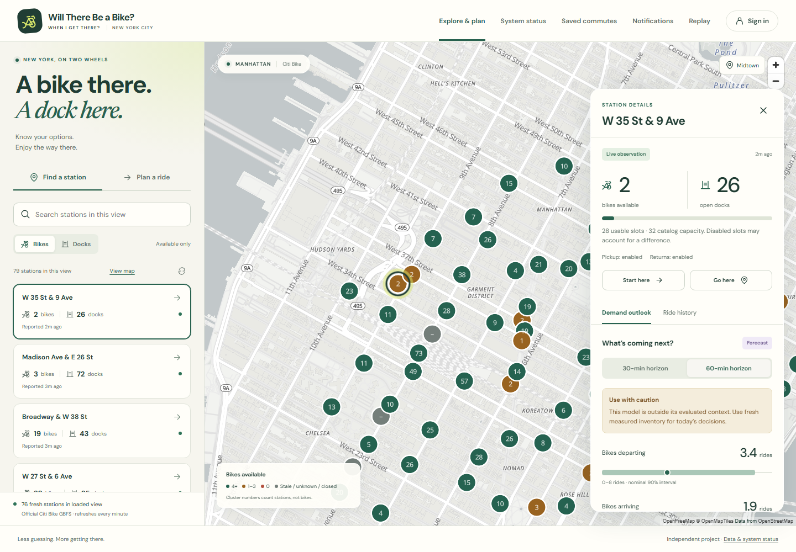
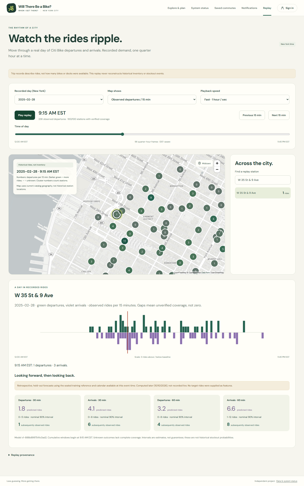
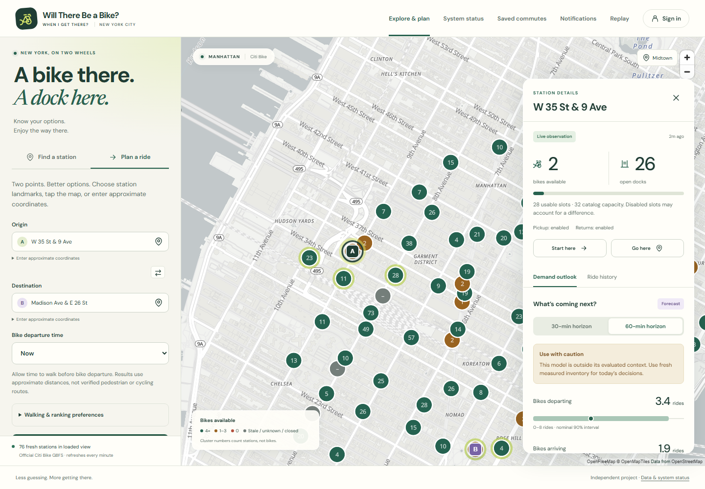
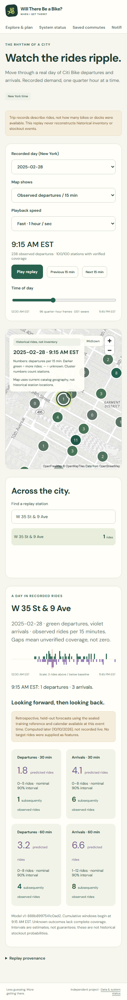
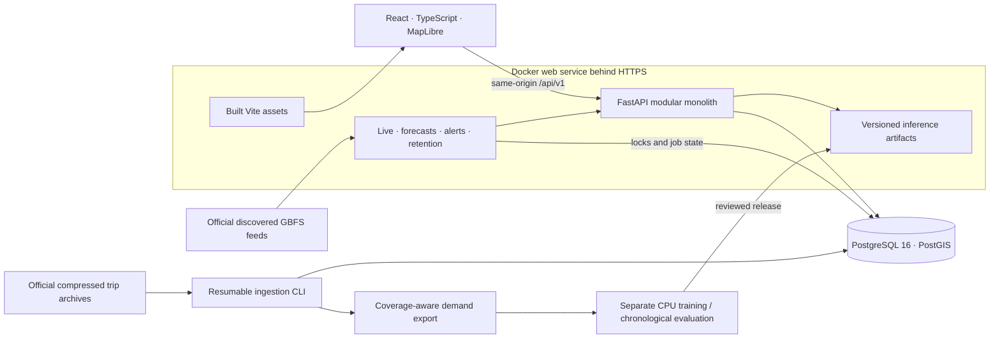

# Will There Be a Bike When I Get There?

[](https://github.com/jiff3/will-there-be-a-bike/actions/workflows/ci.yml)
[](LICENSE)

**A bike there. A dock here. Less guessing in between.**

Bike-share trips have two failure points: an empty pickup station and a full destination. This app combines official Citi Bike observations, station-level demand forecasts and explainable alternatives. Save a commute, monitor measured inventory, and replay the city's historical ride patterns.

A resource-conscious modular monolith, with chronological model evaluation and explicit fallback rules. Ride counts are never presented as historical inventory or independently validated stockout probabilities.



*Captured from the real-data application on October 10, 2026. Freshness and out-of-season model warnings are shown honestly. No live deployment is published.*

## Try the offline app

Requires Docker Desktop (Linux containers), Compose v2. No API key or dataset download. Initial image downloads/builds need internet; the running demo uses a tile-free MapLibre style and local fixtures.

```bash
docker compose -f compose.demo.yml up --build --wait --wait-timeout 180
```

Open **http://localhost:8080**. Select a demo station, inspect its qualified forecast, choose **Start here**, plan to the other station, and open **Replay**. Register a disposable account to save/edit/delete commutes. Demo values are explicitly synthetic; recommendations are distance-only. Alerts require real measurements and intentionally cannot trigger from demo stations.

Stop with `docker compose -f compose.demo.yml down`; its separate volume preserves accounts/commutes and never reuses live/QA data. Both services have 1 GB limits; allow extra memory for Docker, builds and browsers. Stop serving before heavy training on an 8 GB host.

**Verification boundary:** production images and the seeded offline app have been built and run from clean GitHub Actions checkouts. The badge above reports the current four-job CI result. Local verification used native PostgreSQL because Docker was unavailable on that host; no hosted deployment is claimed. [Container/CI results](docs/GITHUB_VALIDATION.md) · [Native verification record](docs/FINAL_VALIDATION.md).

## What works

- Responsive MapLibre discovery/clustering, bike/dock counts, operational flags and timestamp-based freshness; attributed/configurable OpenFreeMap basemap.
- Server-side 30-/60-minute demand forecasts, count intervals, interpretable drivers, conservative inventory scenarios and explained pickup/drop-off alternatives. No ML duplicated in JavaScript.
- Argon2id accounts, PostgreSQL-backed HttpOnly sessions, CSRF protection, auth throttling and private saved commutes.
- Scheduled in-app alerts, read/unread history, cooldowns and deduplication; no external email/SMS dependency.
- Actual 15-minute historical demand replay with timeline/playback/speed controls, station charts and explicitly retrospective held-out forecast comparisons.
- Streamed/resumable imports, coverage/provenance checks, indexed spatial queries, discovered GBFS polling, coordinated jobs and bounded cleanup.



<details>
<summary>More views: commute planning and mobile replay</summary>

### Explainable commute alternatives



### Replay on a smaller screen



</details>

## Architecture



Managed production serves built React directly from FastAPI behind provider HTTPS, one worker and a private database. Existing nginx/Compose deployment remains supported. Training is never a serving request. No Redis, Kafka or Kubernetes.

**Stack:** React/TypeScript/Vite/MapLibre; Python 3.12/FastAPI/Pydantic, async SQLAlchemy/Alembic; PostgreSQL/PostGIS; CPU LightGBM and seasonal baselines; pytest/Vitest/Playwright/Locust; Docker Compose/GitHub Actions.

## Forecasting: measured, not advertised

The reproduced experiment uses **950,604 valid observed rides**, **100 stations**, **566,400 station/15-minute rows**, January–February 2025. Unknown coverage stays missing, not zero. Shared Python features use only issuance-time information. Fitting, model selection, calibration and February 18–28 final audit are separate chronological periods.

Held-out MAE, rides per station/horizon:

| Target | Seasonal (deployed) | Recent baseline | Calendar LightGBM | Lag LightGBM |
| --- | ---: | ---: | ---: | ---: |
| Departures · 30 min | 1.4280 | 1.4848 | 1.3428 | 1.3370 |
| Departures · 60 min | 2.3910 | 2.4553 | 2.1547 | 2.1922 |
| Arrivals · 30 min | 1.3856 | 1.4902 | 1.3464 | 1.3506 |
| Arrivals · 60 min | 2.2793 | 2.4740 | 2.1734 | 2.1898 |

**Why ship the baseline?** It won model-selection validation for all targets. LightGBM's lower final-period error does not justify changing the selection rule retrospectively. Approved artifact: `v1-888b8997541c0ad2`. Actual re-training reproduced it in **48.6 seconds**, sampled peak RSS **177.6 MiB**, two CPU threads.

Nominal 90% intervals had 89.79–92.39% empirical final-period coverage. The packaged winter artifact is old/out-of-season for current use: low confidence is explicit and unsupported inventory risk is suppressed. Scenario probabilities are **not calibrated stockout rates**. [Full metrics/charts](docs/ml-evaluation/REPORT.md) · [ML reproduction](docs/ML.md).

## Develop with real data

Requirements: Docker Desktop with Compose v2. Development Compose configures three 1 GB service memory limits; allow additional RAM for Docker, builds and browsers, and verify actual usage on your host.

```bash
cp .env.example .env
docker compose up --build
```

On PowerShell, use `Copy-Item .env.example .env`. Open <http://localhost:5173>; API documentation is at <http://localhost:8000/docs>. Migrations run automatically before the API starts.

Common commands are available through `npm run <command>` on every platform, or through the `Makefile`:

```bash
npm run test
npm run lint
npm run typecheck
npm run prod
```

Production Compose requires non-default database values, an HTTPS `APP_PUBLIC_ORIGIN`, a one-off migration release and TLS ingress before its internal nginx listener on port 8080. See [production security and deployment](docs/SECURITY.md); development still migrates automatically.

## Repository layout

- `backend/`: API, domain modules, persistence, migrations, and pytest suite.
- `frontend/`: responsive React application, MapLibre map, Vitest and Playwright tests.
- `docs/ARCHITECTURE.md`: decisions, data flow, planned schema, and phased delivery plan.
- `.github/workflows/ci.yml`: backend and frontend quality gates.

Live jobs bootstrap a bounded real station catalog; provider failures remain empty/stale, not synthetic. Default imports cover 100 stations/two months without loading whole archives into RAM.

Real Citi Bike ingestion is now available: streamed/resumable historical trips, measured GBFS snapshots, 15-minute demand exports and spatial inventory queries. See [data operations](docs/DATA_INGESTION.md) for real backfills, offline demo commands, coverage semantics and resource limits.

See the [original data validation record](docs/DATA_VALIDATION.md) for imports and the [backend validation record](docs/BACKEND_VALIDATION.md) for subsequent actual PostgreSQL/PostGIS publication and HTTP tests.

The [ML runbook](docs/ML.md) documents train/evaluate/backtest/predict commands, separate CPU training, approved inference artifacts, uncertainty and low-confidence behavior. The [measured report](docs/ml-evaluation/REPORT.md) compares seasonal/recent baselines and eight LightGBM candidates on chronological periods. The seasonal baseline remains deployed because it won model-selection validation. API model metadata is at `/api/v1/forecasts/model`; forecast requests use `/api/v1/forecasts/predict` and measured database inventory. The old winter artifact correctly declines to claim reliable present-day stockout probabilities.

The [API and operations runbook](docs/API.md) covers pagination/spatial filters, live freshness, historical demand, predictions, recommendations, cookie/CSRF flows, job coordination, metrics and retention. OpenAPI is available at `/docs` and `/openapi.json` unless explicitly disabled.

```bash
docker compose exec backend python -m app.modules.ingestion.cli --data-dir /app/data/real stations --limit 100 --publish
docker compose exec backend python -m app.modules.ingestion.cli --data-dir /app/data/real backfill --start 2025-01-01 --end 2025-03-01 --publish
docker compose exec backend python -m app.modules.ingestion.cli --data-dir /app/data/real aggregate --start 2025-01-01 --end 2025-03-01
docker compose exec backend python -m app.modules.ingestion.cli --data-dir /app/data/real validate --start 2025-01-01 --end 2025-03-01
docker compose exec backend python -m app.modules.replay.cli publish --data /app/data/real/features.jsonl
```

Keep the same catalog/staging directory throughout. Imports resume/deduplicate and remove completed raw downloads. Recover pre-training geography, then run the separate trainer using [ML.md](docs/ML.md). Heavy backfills/training belong locally, not on the small hosted web service.

## Quality engineering

Latest local execution: **173 pytest tests against real PostgreSQL/PostGIS**, **44 Vitest tests**, **six persisted Chromium workflows over local HTTPS**, two offline UI smoke tests and two integrated offline journeys. Coverage: backend **81.76%**, frontend lines **78.37%**. The real-data recorded walkthrough and all six migration upgrade/downgrade/re-upgrade/drift checks passed. Lint/types/formatting/frontend production build passed.

Tests exercise ownership/CSRF, resumability/duplicates, feature leakage/serialization, geographic ranking, job coordination, malformed/stale/out-of-order feeds, unavailable models, interrupted DB transactions, alerts and browser recovery. Automated tests forbid external provider HTTP. CI uses disposable PostGIS/fixtures and retains coverage/JUnit/traces/container diagnostics. Image and container checks run on GitHub's Ubuntu runners, separately from the native Windows measurements.

All four jobs passed in the [published CI run](https://github.com/jiff3/will-there-be-a-bike/actions/runs/38088411123): **173 backend tests**, **44 frontend tests**, **ten browser journeys**, migration round-trip, production image builds and clean-checkout offline startup. [Runner results and limitations](docs/GITHUB_VALIDATION.md).

The preceding bounded loopback benchmark measured **67.39 req/s**, aggregate **p95 34 ms**, zero failures at eight users, API peak RSS **136.08 MiB**. Warm-cache synthetic workload, not a hosted SLO or an actual 8 GB-host qualification. [Testing architecture, commands and measured results](docs/TESTING.md).

## Automated walkthrough

With the offline app running, from `frontend/`:

```bash
npm ci
npx playwright install chromium
BIKE_E2E_EXTERNAL=1 BIKE_E2E_DEMO=1 BIKE_E2E_BASE_URL=http://localhost:8080 npx playwright test demo.spec.ts
```

PowerShell sets these variables using `$env:NAME='value'` before the command. [Walkthrough source](frontend/e2e/demo.spec.ts) exercises actual station selection → 60-minute forecast → alternatives → replay → mobile layout and records video/screenshots in ignored `frontend/test-results/`. `BIKE_DEMO_CAPTURE=1` refreshes README screenshots; `BIKE_DEMO_STATION` selects an explicitly chosen real-data station. No mocked metrics or fictional product images.

## Deployment

[Render Blueprint](render.yaml), [single-origin Dockerfile](Dockerfile) and [manual CI-gated release](.github/workflows/deploy-render.yml) are prepared. Models persist as immutable image contents; observations/accounts/jobs persist in managed PostgreSQL. One-off release migrations and lock-coordinated scheduled updates are configured.

**Not deployed.** No hosting purchase, credentials committed or live URL invented. [Exact owner/account steps, security and operations](docs/DEPLOYMENT.md). Repository publication and CI do not deploy a hosted application; deployment workflows remain explicitly opt-in.

## Troubleshooting and honest limitations

- Docker unavailable: enable Docker Desktop's Linux engine/Compose v2; free development ports 5173/8000/5432 or demo port 8080. Demo PostgreSQL is private.
- Readiness 503: check connectivity/migrations; don't bypass revision checks. Auth requires the exact origin and production secure cookies.
- Empty/stale stations: inspect feed/job timestamps. Provider failure is not zero inventory. Offline map intentionally has no street tiles.
- Empty replay: publish a coverage-aware export. Retrospective comparisons require the exact evaluated checksum and supported final-period dates.
- Unavailable model: verify approved artifact hashes/library versions and restart after activation. Use qualified inventory/distance fallback; never upload untrusted models.
- Two winter months do not represent all seasons, weather, unmet demand or rebalancing. No historical inventory or calibrated stockout claims.
- Walking is great-circle distance × 1.3, not pedestrian routing or fabricated journey time. Planner covers now/next hour, not a distant scheduled commute.
- In-app notifications only. Email verification/recovery, MFA, stockout calibration, hosted soak/security/accessibility testing and backup/restore drills remain future work.

## License and contributing

[MIT code license](LICENSE); operator data retains its [data use policy](https://citibikenyc.com/data-sharing-policy); map attribution remains visible. Independent project, not official Citi Bike. [Contributing](CONTRIBUTING.md) · [Security reporting](SECURITY.md).

