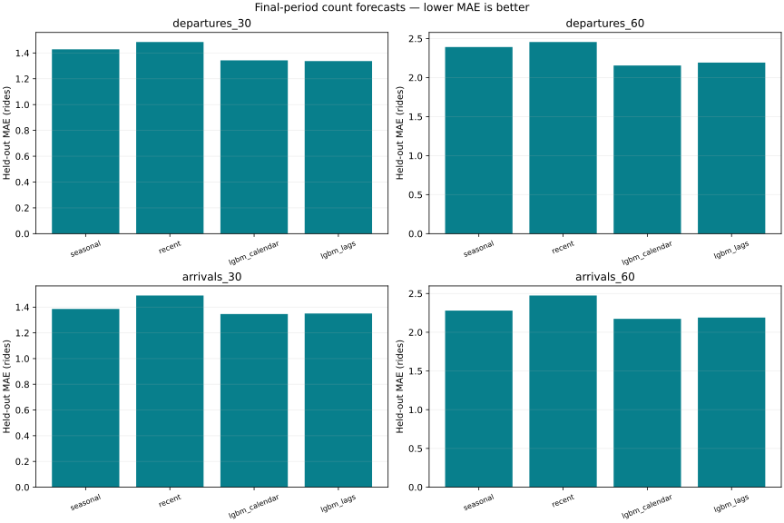
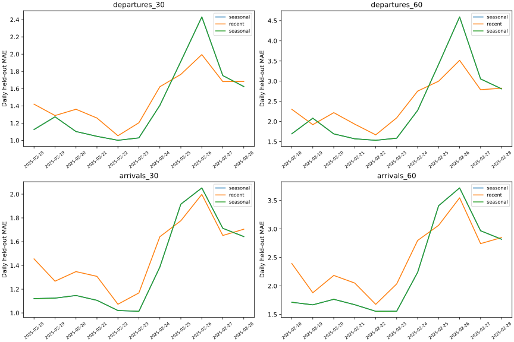
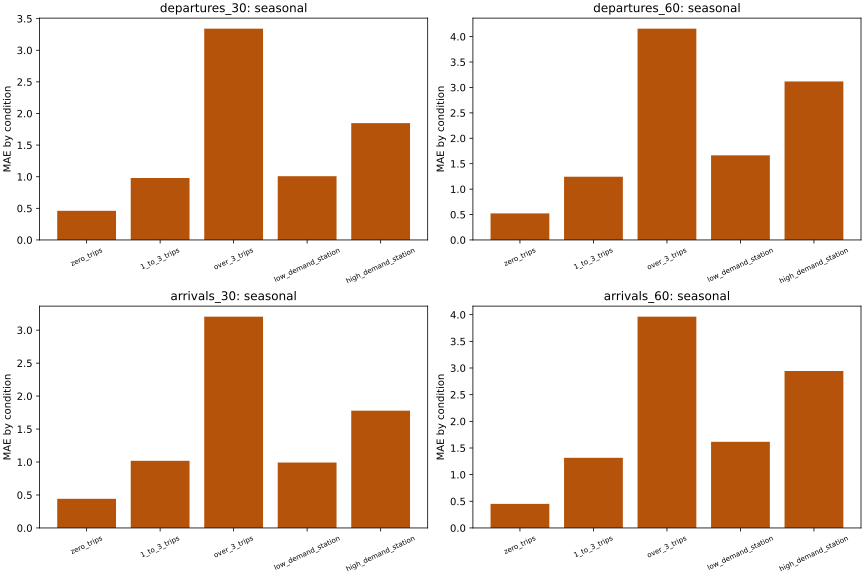

# Real-data forecasting evaluation

Artifact: `v1-888b8997541c0ad2`

Data SHA-256: `7d866d3678b0469585a4865619a4744fb7af07ade7e0e5ebd635b39d9f306447`

These are retrospective event-time count evaluations, not historical online deployments.
Recent-count inputs assume a completed-trip provider with the configured delay;
public GBFS does not supply them. Archive-only forecasts do not require these inputs.

Selection uses early validation MAE. Late validation calibrates intervals.
Final test is never fitted or tuned; its only selection role is a one-way rejection gate
to retain a baseline when the candidate fails to beat it.

| Target | Model | Test MAE | RMSE | Poisson deviance |
|---|---|---:|---:|---:|
| departures_30 | seasonal | 1.4280 | 2.4988 | 1.6957 |
| departures_30 | recent | 1.4848 | 2.5169 | 4.9899 |
| departures_30 | lgbm_calendar | 1.3428 | 2.1901 | 1.3211 |
| departures_30 | lgbm_lags | 1.3370 | 2.1895 | 1.3046 |
| departures_60 | seasonal | 2.3910 | 4.2537 | 2.3372 |
| departures_60 | recent | 2.4553 | 4.1389 | 4.8960 |
| departures_60 | lgbm_calendar | 2.1547 | 3.5636 | 1.6801 |
| departures_60 | lgbm_lags | 2.1922 | 3.6127 | 1.6828 |
| arrivals_30 | seasonal | 1.3856 | 2.4133 | 1.5901 |
| arrivals_30 | recent | 1.4902 | 2.5572 | 4.9472 |
| arrivals_30 | lgbm_calendar | 1.3464 | 2.2621 | 1.3436 |
| arrivals_30 | lgbm_lags | 1.3506 | 2.2368 | 1.3235 |
| arrivals_60 | seasonal | 2.2793 | 4.0110 | 2.0897 |
| arrivals_60 | recent | 2.4740 | 4.2280 | 4.8767 |
| arrivals_60 | lgbm_calendar | 2.1734 | 3.6980 | 1.7103 |
| arrivals_60 | lgbm_lags | 2.1898 | 3.6677 | 1.6931 |

## Accepted models and uncertainty

- departures_30: archive **seasonal**, timely-history **seasonal**; archive interval coverage 91.610%, mean width 4.62 rides.
- departures_60: archive **seasonal**, timely-history **seasonal**; archive interval coverage 89.794%, mean width 7.55 rides.
- arrivals_30: archive **seasonal**, timely-history **seasonal**; archive interval coverage 92.385%, mean width 4.66 rides.
- arrivals_60: archive **seasonal**, timely-history **seasonal**; archive interval coverage 90.677%, mean width 7.54 rides.

Full per-station, zero/positive-demand, and low/high-station-demand metrics,
global gain importance, daily backtests, source identities, training configuration
and measured resource use are in `evaluation.json`.

Intervals are residual-based estimates with empirical temporal coverage, not guarantees.
Simulated empty/full risk is NOT empirically calibrated stockout probability.
